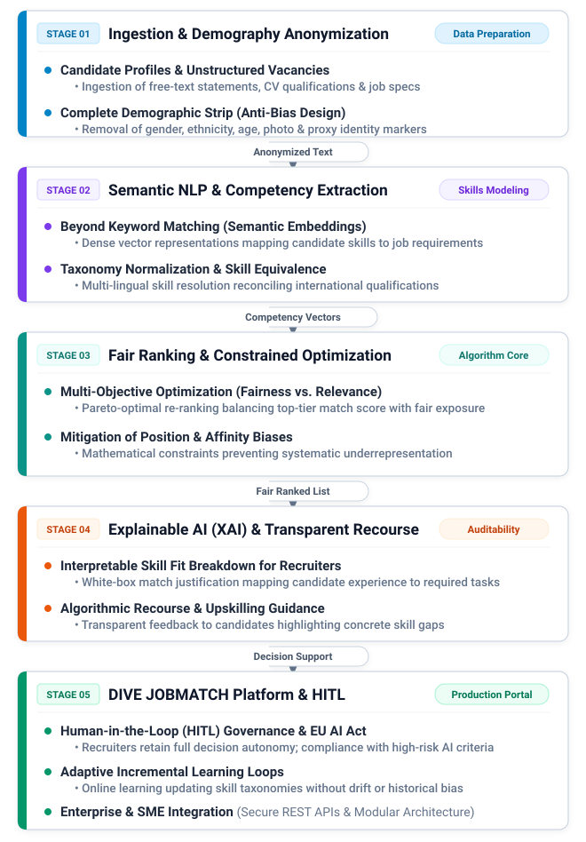

## Project Summary

**AI-Driven Job Matching Platform** is an applied AI research project developed in strategic collaboration between **DIVE connected GmbH** and **Heinrich Heine University Düsseldorf (HHU)** ([Official Company Website](https://www.divesquared.com/)). As part of this initiative, the consortium actively engaged in fundraising and formulated competitive grant applications for programs such as the **BMWK IGP** (Innovationsprogramm für Geschäftsmodelle und Pionierlösungen) and the state innovation competition **NEXT.IN.NRW**.

The project tackles Germany's acute skilled labor deficit (with over 400,000 unfilled vacancies in North Rhine-Westphalia alone) by designing a non-discriminatory, skills-first job matching platform. Conventional platforms (e.g., LinkedIn, Indeed, and StepStone) rely predominantly on literal keyword matching. Moreover, human recruiters are prone to biases that may disadvantage certain groups of applicants.

To tackle these issues, the research project aims to develop a platform that matches talents with open positions using semantic similarity search. To prevent any potential bias from the recruiting process, the platform anonymizes applicants' sensitive information, such as name, gender, age, and nationality.

The engineering and scientific core—led by HHU Computer Science—focused on solving four fundamental challenges:

1. **Semantic Skill Extraction**: Embedding applicant qualifications, certificates, and free-text narratives into a semantic vector space to enable skills-based matching.
2. **Fair Ranking**: Implementing multi-objective ranking algorithms that enforce fair exposure across demographic subgroups while preserving high matching utility.
3. **Explainable AI (xAI)**: Providing transparent, white-box justifications for why candidates are matched.

---

<!-- ## Software & Systems Developed

### 1. Core AI Matching Engine — Semantic Skill Extraction & Embedding Pipeline

* **Lead Role**: Machine Learning Architecture & Lead Data Science Consultant
* **Core Functionality**: High-throughput NLP pipeline engineered to ingest and normalize unstructured vacancy descriptions alongside applicant CVs and free-text profile statements.
* **Semantic Vector Modeling**: Leverages dense transformer-based embeddings to project qualifications and vacancy requirements into a shared semantic space, enabling nuanced semantic retrieval rather than shallow string matching.
* **Taxonomy Normalization & International Equivalence**: Automatically reconciles disparate job titles, cross-border educational credentials, and localized terminology into a standardized European skill taxonomy (ESCO-aligned), eliminating artificial barriers for international talent.

### 2. Fair Ranking Engine — Constrained Multi-Objective Candidate Ranking

* **Algorithmic Core**: Formulates the talent recommendation list as a **fair ranking optimization problem**.
* **Mitigating Position Bias & Disparate Exposure**: Standard ranking algorithms heavily favor historical majority groups due to biased training signals. The engine integrates fairness constraints (e.g., bounded demographic parity and equalized exposure in top-$k$ ranked slots) directly into the ranking objective.
* **Pareto-Optimal Re-Ranking**: Dynamically balances match precision against equity constraints, ensuring companies receive optimal candidate recommendations without compromising fairness benchmarks.

### 3. Explainability Module (XAI) & Actionable Algorithmic Recourse

* **Transparent Justification**: Generates interpretable, feature-attributed breakdowns for each recommended match, detailing which exact demonstrated skills and experiences contributed to the candidate's relevance score.
* **Candidate Recourse**: Rather than issuing opaque black-box rejections, the engine computes minimal actionable recourse paths—highlighting the specific qualifications or micro-credentials that would elevate a candidate into the top tier for a given target role.

### 4. DIVE JOBMATCH Platform Integration & Prototype Architecture

* **Architecture**: Production-grade microservices designed to integrate into the DIVE JOBMATCH ecosystem via secure RESTful APIs (FastAPI, Docker, PostgreSQL).
* **Automated Anonymization Filter**: Completely removes sensitive demographic markers (names, gender, photographs, nationality, age, and postal proxies) at ingestion before any algorithmic scoring occurs.
* **Recruiter Decision-Support Interface**: An interactive web-based dashboard offering HR professionals a blind, skills-focused evaluation workflow with transparent match insights. -->

<!-- 
## ML-driven Fair Matching & Ranking Architecture

 -->

### Semantic Similarity Search vs. Keyword Matching

* Traditional keyword matching penalizes qualified candidates whose resumes lack exact keywords or whose qualifications originate from different curricula.
* The system addresses this by deploying multi-lingual semantic encoders that extract latent skill competencies from free-text descriptions and map them against requirements extracted from job descriptions.

### Fair Ranking

* Recruiters get a ranked list of anonymized candidates for each job position w.r.t. how well they match the job requirements, without any demographic information avoiding any bias.
* Fair ranking algorithms may be deployed to avoid proxy discrimination based on protected characteristics.

---

## Data Engineering, Privacy & European AI Act Governance

* **Privacy by Design**: Data sanitization pipelines that purge Personally Identifiable Information (PII) and demographic signals to ensure that downstream tasks process solely the qualification.
* **EU AI Act Alignment**: Recruitment algorithms are categorized as **High-Risk AI Systems** under Annex III of the EU AI Act. The architecture was designed to satisfy European standards:
  * Comprehensive technical documentation and model audit logging.
  * Human-in-the-Loop (HITL) architecture where AI strictly acts as an advisory recommendation tool; recruiters retain full decision autonomy.
  * Bias auditing and accuracy validation protocols to prevent algorithmic discrimination.
* **GDPR Compliance**: Designed for deployment within encrypted EU cloud infrastructure with strict data isolation, role-based access control (RBAC), and adherence to applicant data deletion rights.

---

## Interdisciplinary Collaboration & Consortium

The initiative brought together an interdisciplinary team:

* **HHU Computer Science (Databases and Information Systems — Prof. Dr. Stefan Conrad & Dr. Manh Khoi Duong)**:
  * Research and development on fair ranking algorithms, semantic NLP pipelines, and the recommendation architecture.
* **HHU Business Administration (Digital Management & Digital Work — Prof. Dr. Marius Wehner & Dr. Lynn Schmodde)**:
  * Experimental research on stakeholder perceptions of AI fairness, trust, and applicant reactions.
* **DIVE connected GmbH (Osia Katsidou & Executive Team)**:
  * Platform requirements, industry stakeholder engagement, corporate partnership networks, enterprise pilot programs, and external UX/UI integration.

---

## Fundraising & Competitive Grant Proposals

To finance and scale the research and platform development, comprehensive funding proposals and work plans were co-authored and submitted to competitive federal and state innovation programs:

* **BMWK IGP (Innovationsprogramm für Geschäftsmodelle und Pionierlösungen)**:
  * Co-authored the collaborative grant application for market-ready innovation (*Marktreifeprojekt*), authoring the technical work packages for Computer Science (*Arbeitspaket Informatik*) covering data preprocessing, NLP semantic matching pipelines, fair ranking formulation, and empirical evaluation against industry benchmarks.
* **NEXT.IN.NRW Innovation Competition**:
  * Formulated early consortium concepts and work breakdown structures aligning university research packages with startup commercialization and platform rollout.

*(Note: Although these applications were not ultimately funded, the proposal process yielded robust algorithmic blueprints, semantic pipeline specifications, and formal requirements for non-discriminatory candidate matching.)*

---

## Research Output

The research into algorithmic fairness, non-discriminatory candidate matching, and fair ranking conducted within this project directly led to peer-reviewed scientific contributions:

* **DaWaK 2025 (Springer LNCS)**: *Fair Proportional Top-k Ranking* — Liebrand, N. A., Duong, M. K., Conrad, S. ([DBLP](https://dblp.org/rec/conf/dawak/LiebrandDC25))
  * *Focus & Contribution*: Investigates algorithmic fairness in top-$k$ candidate selection and ranking mechanisms, introducing methods to guarantee proportional representation across protected demographic groups while preserving optimal matching utility.

---

## Research Foundations

The algorithmic fairness formulations and bias mitigation techniques behind the platform build upon Dr. Duong's doctoral research and publications in responsible machine learning:

* **Doctoral Dissertation (2025)**: *Measuring and Mitigating Bias in Machine Learning* — Duong, M. K. (Heinrich Heine University Düsseldorf, Grade: 1.0 *magna cum laude*).
* **ECAI 2024 (IOS Press)**: *(Un)certainty of (Un)fairness: Preference-Based Selection of Certainly Fair Decision-Makers* — Duong, M. K., Conrad, S.
* **AEQUITAS 2024 (CEUR)**: *Measuring and Mitigating Bias for Tabular Datasets with Multiple Protected Attributes* — Duong, M. K., Conrad, S.
* **DaWaK 2024 (Springer LNCS)**: *Trusting Fair Data: Leveraging Quality in Fairness-Driven Data Removal Techniques* — Duong, M. K., Conrad, S.

---

## References & Links

* **DIVE connected GmbH Official Website**: [divesquared.com](https://www.divesquared.com/)
* **DIVE JOBMATCH Platform**: [divesquared.com/jobmatch](https://www.divesquared.com/)
* **HHU Databases and Information Systems Group**: [dbs.cs.uni-duesseldorf.de](https://dbs.cs.uni-duesseldorf.de/)
* **HHU Digital Management & Digital Work Group**: [digitalwork.hhu.de](https://www.digitalwork.hhu.de/)
* **DaWaK 2025 Publication (DBLP)**: [dblp.org/rec/conf/dawak/LiebrandDC25](https://dblp.org/rec/conf/dawak/LiebrandDC25)
* **NEXT.IN.NRW Innovation Program**: [in.nrw/next](https://www.in.nrw/next)
* **BMWK Innovation Program (IGP)**: [bundeswirtschaftsministerium.de/igp](https://www.bundeswirtschaftsministerium.de/Redaktion/DE/Artikel/Innovation/igp.html)
